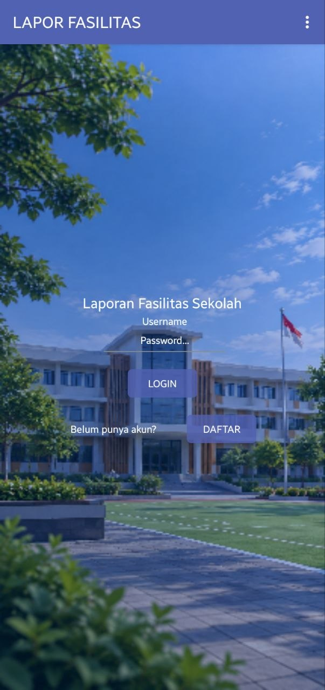
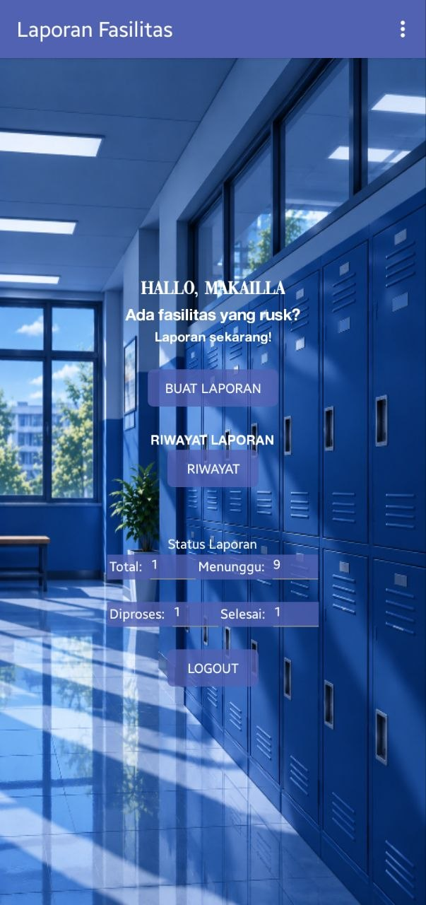
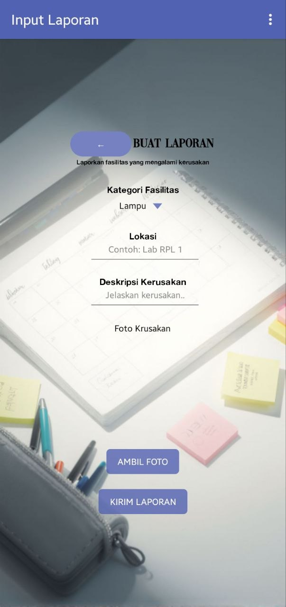
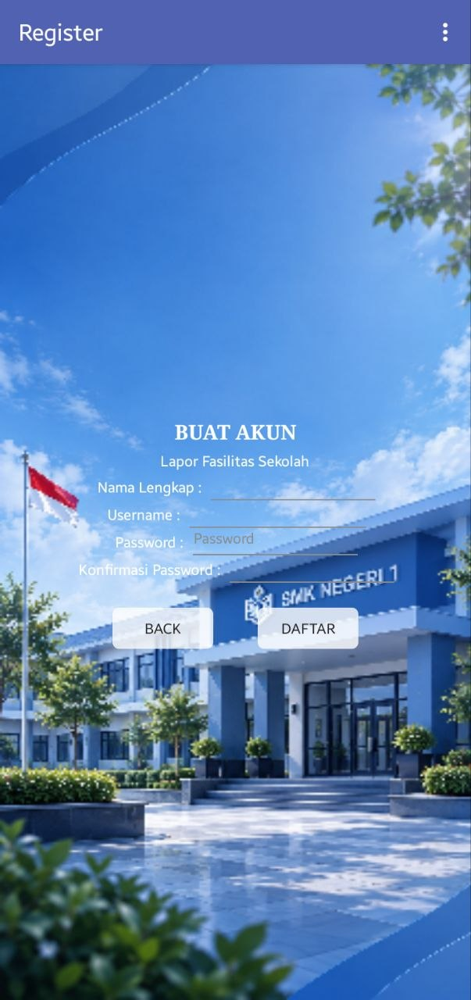
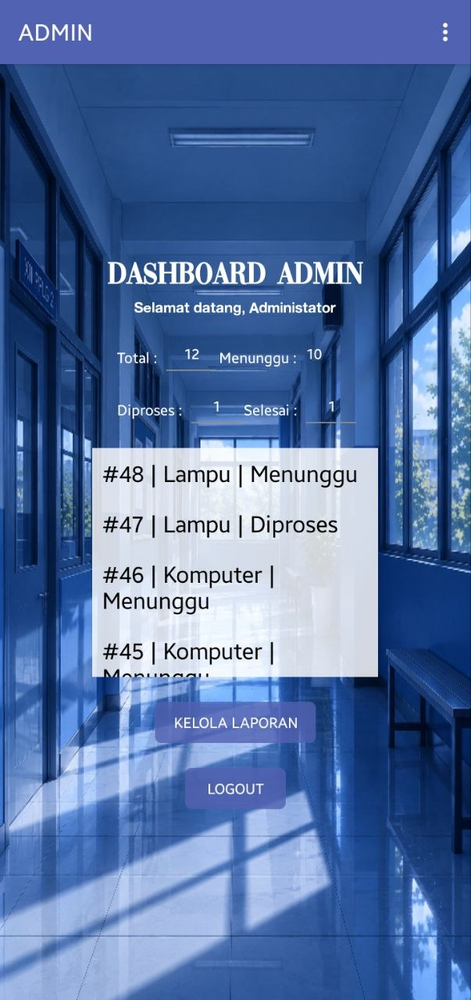
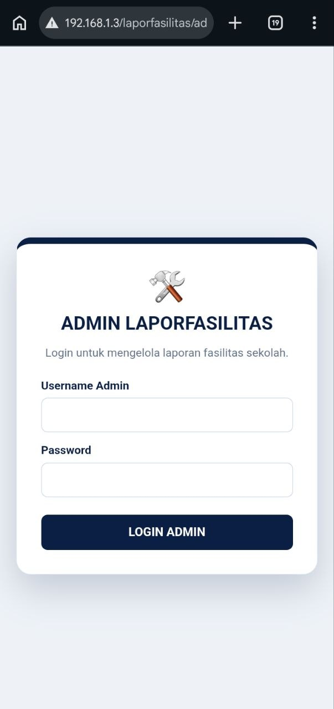
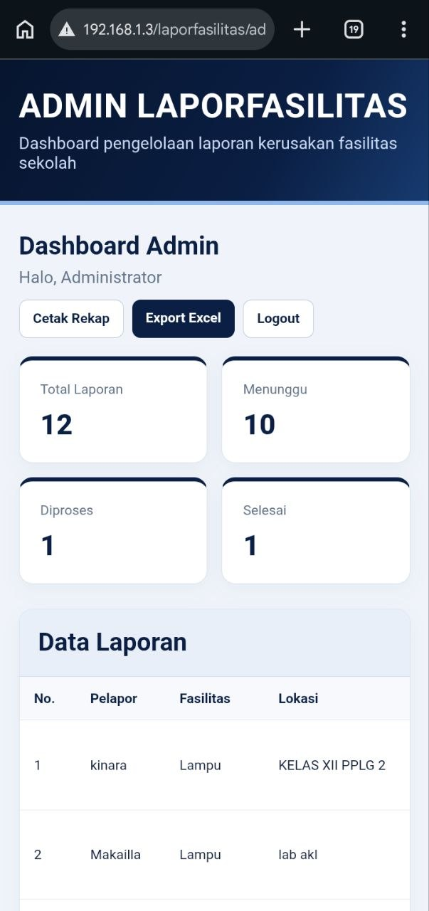

# Aplikasi LaporFasilitas

Aplikasi pelaporan kerusakan dan masalah fasilitas berbasis Android yang terhubung dengan backend PHP dan database MySQL.

## Teknologi
- MIT App Inventor
- PHP
- MySQL
- XAMPP
- HTML, CSS, dan JavaScript

## Fitur
- Pelaporan kerusakan fasilitas
- Pengiriman foto laporan
- Penyimpanan laporan ke database
- Dashboard web admin
- Pengelolaan status laporan
- Cetak rekap laporan

## Struktur Project
- `Database/` — struktur database MySQL
- `apk/` — file project MIT App Inventor dan APK
- `laporfasilitas/admin/` — halaman web admin
- `laporfasilitas/api/` — endpoint API
- `laporfasilitas/config/` — contoh konfigurasi database

## Instalasi
1. Siapkan PHP dan MySQL menggunakan XAMPP.
2. Buat database bernama `laporfasilitas`.
3. Impor file SQL yang disediakan.
4. Sesuaikan konfigurasi database lokal.
5. Tempatkan backend pada direktori server web.
6. Sesuaikan URL API di aplikasi Android.
7. Jalankan aplikasi dan web admin.

## Keamanan
Jangan gunakan password asli atau data pribadi dalam repository. Gunakan konfigurasi database lokal milik masing-masing pengguna.

## Status
Project dalam pengembangan.

## 📸 Screenshot Aplikasi

### 1. Login Android

### 2. Dashboard Pengguna

### 3. Daftar Laporan dan Status
.

### 4. Dashboard Register
.

### 5. Dashboard Admin
.

### 5. Web Login Admin
.

### 6. Web Dashboard Admin
.
